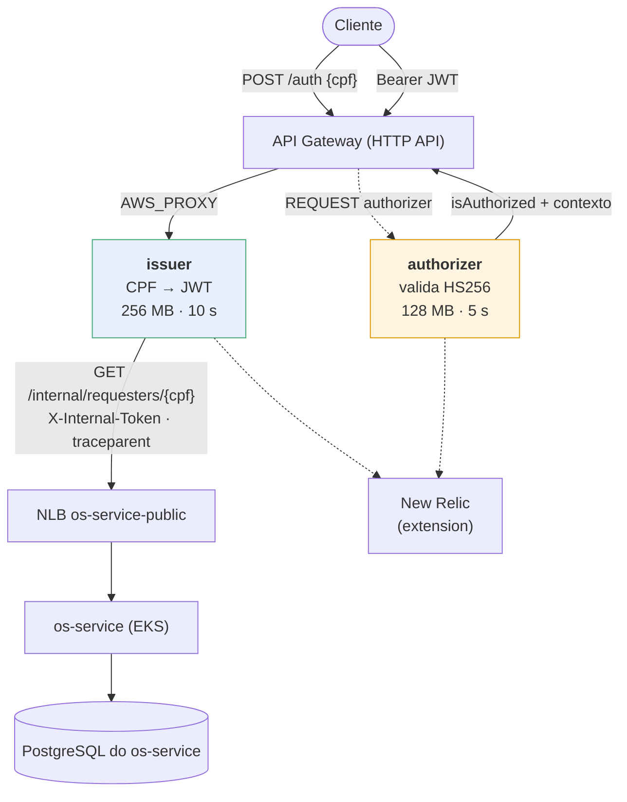
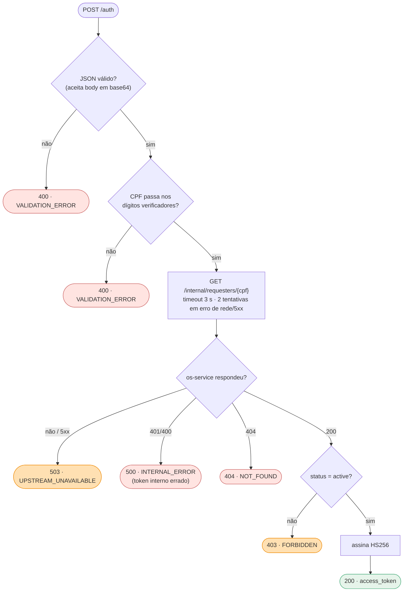
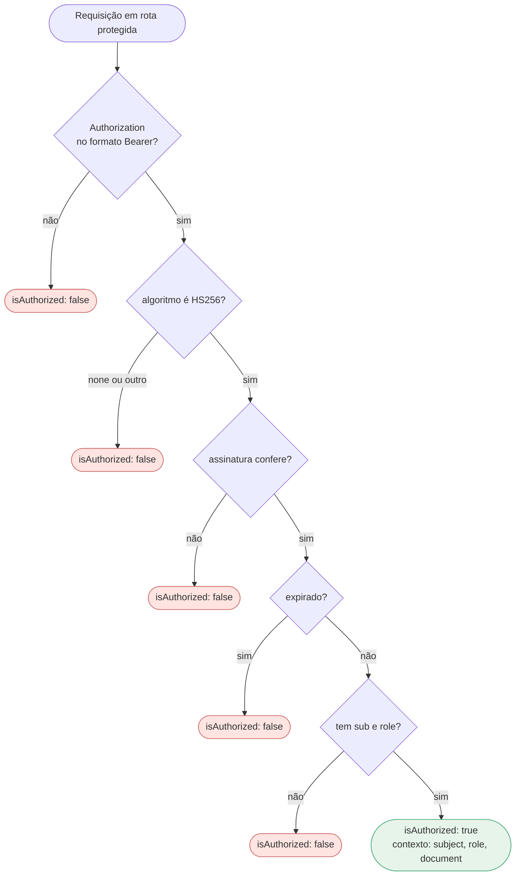

# postech-tc4-lambda-auth

**Autenticação serverless por CPF** do sistema de gestão de oficinas mecânicas, já na arquitetura de microsserviços.

Tech Challenge Fase 4, FIAP Pós Tech SOAT.

## Propósito

O cliente envia o CPF e recebe um **JWT** que dá acesso às rotas protegidas do API Gateway. São duas functions:

- **issuer**: valida o CPF, confere no **os-service** se o cliente existe e está ativo, e assina o token;
- **authorizer**: Lambda authorizer do API Gateway, que valida o JWT antes de a requisição chegar aos serviços.

### O que mudou da Fase 3

| Fase 3 | Fase 4 |
|---|---|
| O issuer abria o PostgreSQL da aplicação e consultava `requesters` | O issuer chama `GET /internal/requesters/{cpf}` no os-service, com `X-Internal-Token`. Cada serviço é dono dos próprios dados |
| Function dentro da VPC, por causa do RDS | Function fora da VPC: não precisa de banco e ganha saída para a internet sem NAT, que a extension do New Relic exige |
| Só CloudWatch Logs | **New Relic** nas duas functions (layer da extension + `nrlambda`), com trace distribuído até o os-service e logs em contexto |
| Erro como `{"error": "texto"}` | Mesmo envelope dos serviços: `{"error": {"code", "message"}}` |

## Tecnologias

- Go 1.26 em AWS Lambda (runtime `provided.al2023`, arm64)
- `golang-jwt/v5` (HS256)
- New Relic Go Agent + `nrlambda` + layer `NewRelicLambdaExtensionARM64`
- Logs estruturados em JSON (`log/slog`), com o CPF mascarado (`***.***.***-25`)
- Terraform (functions, log groups, layer) e GitHub Actions com SonarQube

## Arquitetura



O `RoundTripper` do New Relic envolve o cliente HTTP: a chamada ao os-service vira um segmento externo e leva os headers W3C (`traceparent`/`newrelic`). Por isso o trace distribuído mostra **Lambda → os-service → Postgres** em uma só linha do tempo.

### Grafo de decisão do issuer



O CPF é validado **antes** da chamada de rede: CPF malformado nunca chega ao os-service. Só erros de rede e 5xx são repetidos, porque a consulta é idempotente. Um 401 indica configuração errada (token interno divergente), e repetir não resolveria.

### Grafo de decisão do authorizer



O authorizer aceita o token do cliente (emitido aqui) e também o da equipe (emitido pelo `POST /api/v1/auth/login` do os-service), porque os dois usam o mesmo `JWT_SECRET`. O algoritmo `none` é recusado explicitamente com `jwt.WithValidMethods`. Os serviços validam o JWT de novo (defesa em profundidade), e o os-service ainda confere se o `document` do token é o dono da OS consultada.

## Estrutura

```
cmd/issuer/            main do issuer: configuração, cliente HTTP com New Relic e start
cmd/authorizer/        main do authorizer
internal/issuer/       handler do POST /auth (validação, respostas, atributos de telemetria)
internal/authorizer/   handler do authorizer (payload 2.0, resposta simples)
internal/requester/    cliente HTTP do os-service (timeout, retry, correlation id)
internal/token/        emissão e verificação do JWT
internal/cpf/          dígitos verificadores
internal/mask/         mascaramento de CPF/e-mail nos logs (LGPD)
internal/telemetry/    trace.id/span.id nos logs e atributos na transação do New Relic
internal/runtime/      logger, env obrigatória e start com ou sem New Relic
test/integration/      CPF → issuer → os-service real → JWT aceito pelo authorizer e pelo os-service
infra/                 Terraform das functions
```

## Contrato do token

| Claim | Valor |
|---|---|
| `sub` | id do cliente no os-service |
| `role` | `client` (a equipe usa `admin`) |
| `email`, `name`, `document` | dados do cliente |
| `iat`, `exp` | emissão e expiração (`JWT_TTL`, padrão 15 min) |

## Respostas do issuer

| Situação | HTTP | `error.code` |
|---|---|---|
| CPF válido e cliente ativo | 200 | `access_token`, `token_type`, `expires_at`, `expires_in` |
| Payload malformado ou CPF inválido | 400 | `VALIDATION_ERROR` |
| Cliente inexistente | 404 | `NOT_FOUND` |
| Cliente inativo | 403 | `FORBIDDEN` |
| os-service fora do ar ou 5xx depois das tentativas | 503 | `UPSTREAM_UNAVAILABLE` |
| Token interno errado ou falha ao assinar | 500 | `INTERNAL_ERROR` |

As respostas levam `X-Correlation-ID`: o do cliente, se veio no request, ou o request id do API Gateway. O mesmo id segue para o os-service e aparece nos logs dos dois lados. A resposta com token vem com `Cache-Control: no-store`.

## Observabilidade

- **Traces**: `nrlambda` abre uma transação por invocação, e a chamada ao os-service continua o trace distribuído.
- **Logs em contexto**: cada log tem `trace.id`, `span.id` e `entity.guid`. A extension envia os logs ao New Relic (`NEW_RELIC_EXTENSION_SEND_FUNCTION_LOGS`).
- **Atributos para dashboards e alertas**: `auth.outcome` (`issued`, `not_found`, `inactive`, `invalid_cpf`, `upstream_unavailable`, `allowed`, `invalid_token`...), `auth.role`, `requester_id` e `correlation_id`. Exemplo de NRQL:

```sql
SELECT count(*) FROM Transaction WHERE appName LIKE '%-auth-issuer' FACET auth.outcome TIMESERIES
```

Sem a licença do New Relic, o Terraform não instala a layer e as functions sobem com `lambda.Start` puro.

## Execução local

```bash
make test         # unitários com race
make cover        # cobertura de internal/ (91%)
make lint         # golangci-lint (gosec, errorlint, bodyclose, noctx...)
make package      # issuer.zip e authorizer.zip (bootstrap arm64)
```

Teste de integração com o os-service de verdade. Suba o `docker compose` do [postech-tc4-os-service](https://github.com/Kc1t/postech-tc4-os-service) e rode o `scripts/smoke-saga.sh` uma vez para cadastrar o cliente de teste:

```bash
make integration  # usa OS_SERVICE_URL=http://localhost:8080 e INTERNAL_API_TOKEN=local-internal-token
```

O teste cobre: token emitido, aceito pelo authorizer e pela rota do cliente no os-service; 403 ao consultar o CPF de outra pessoa; 404 para CPF sem cadastro; e 500 com token interno errado.

> **Dockerfile**: não se aplica. As functions sobem como zip no runtime `provided.al2023`.

## Variáveis de ambiente

| Variável | Function | Descrição |
|---|---|---|
| `OS_SERVICE_URL` | issuer | URL do os-service (no Terraform, vazio = procura o NLB `os-service-public` pela tag do Kubernetes) |
| `INTERNAL_API_TOKEN` | issuer | mesmo valor do os-service |
| `JWT_SECRET` | as duas | segredo HS256, o mesmo dos serviços |
| `JWT_TTL` | issuer | validade do token (padrão `15m`) |
| `UPSTREAM_TIMEOUT` | issuer | timeout da chamada ao os-service (padrão `3s`) |
| `NEW_RELIC_*` | as duas | definidas pelo Terraform quando há licença |

`OS_SERVICE_URL`, `INTERNAL_API_TOKEN` e `JWT_SECRET` são obrigatórias: sem elas a function falha já no cold start, em vez de emitir token com segredo vazio.

## CI/CD

Pipeline próprio em [`.github/workflows/ci.yml`](.github/workflows/ci.yml). A `main` é protegida: só recebe PR, com os três primeiros jobs obrigatórios.

| Job | O que faz |
|---|---|
| Lint, SAST e testes | `go mod tidy` limpo, `gofmt`, `go vet`, golangci-lint, gosec, testes com race, **cobertura mínima de 80%** e govulncheck |
| SonarQube | sobe o SonarQube Community num container do próprio job (o repo é privado), cria um quality gate (cobertura ≥ 80%, duplicação ≤ 3%, nota A em confiabilidade, segurança e manutenibilidade), importa a cobertura e os relatórios do golangci-lint/gosec, e falha se o gate reprovar ([`.github/scripts/sonar.sh`](.github/scripts/sonar.sh)) |
| Terraform | `fmt -check`, `validate` e tfsec (as exceções têm a justificativa no próprio `main.tf`: Learner Lab sem CMK, trace pelo New Relic em vez do X-Ray) |
| Deploy (push) | `make package`, `terraform apply` só na `main` (ambiente único, ADR-0021), smoke test com `aws lambda invoke` e os invoke ARNs no resumo do job |

O deploy só roda com a variável de repositório `AWS_DEPLOY_ENABLED=true`, porque as credenciais do Learner Lab expiram a cada sessão.

Secrets do ambiente: `AWS_ACCESS_KEY_ID`, `AWS_SECRET_ACCESS_KEY`, `AWS_SESSION_TOKEN`, `TF_STATE_BUCKET`, `INTERNAL_API_TOKEN`, `JWT_SECRET` e `NEW_RELIC_LICENSE_KEY`. Variáveis: `AWS_REGION`, `OS_SERVICE_URL` (opcional) e `NEW_RELIC_ACCOUNT_ID`.

## Infraestrutura

- A execution role é a `LabRole`, porque o Learner Lab não permite criar IAM.
- O Terraform é dono do código: o `source_code_hash` dos zips dispara a atualização no `apply`.
- A URL do os-service sai do NLB que o Kubernetes cria para o Service `os-service-public` (tag `kubernetes.io/service-name = <namespace>/os-service-public`). Por isso a ordem de deploy é: cluster → os-service → lambda-auth → rotas do gateway (no [postech-tc4-infra-k8s](https://github.com/Kc1t/postech-tc4-infra-k8s)).
- A rota `/internal/*` do os-service não existe no API Gateway. Ela só é acessível pelo NLB, e mesmo assim exige `X-Internal-Token` (comparação em tempo constante). Num ambiente sem as restrições do Learner Lab, o próximo passo seria um NLB interno com VPC Link e a Lambda na VPC com NAT.

## Testes

| Pacote | Cobertura | O que cobre |
|---|---|---|
| `internal/requester` | 97,8% | 200, 404, inativo, 5xx com retry, recuperação na 2ª tentativa, rede fora, contexto cancelado, 401 sem retry, JSON inválido |
| `internal/issuer` | 95,2% | token emitido e verificável, body em base64, todos os erros e o correlation id |
| `internal/authorizer` | 96,0% | token válido, header em outra caixa, ausente, sem esquema, vazio, expirado, outro segredo |
| `internal/cpf` | 94,1% | dígitos verificadores, formatação, sequências repetidas |
| `internal/token` | 81,8% | emissão, verificação, segredo errado, expirado, algoritmo `none` |
| `internal/telemetry`, `mask` | 90,9% e 100% | logs com e sem transação, mascaramento |
| `internal/runtime` | 60,0% | logger e variáveis de ambiente; o `Start` com New Relic e o `os.Exit` do `Require` só rodam dentro da Lambda |
| **Total (`internal/`)** | **91,3%** | |
