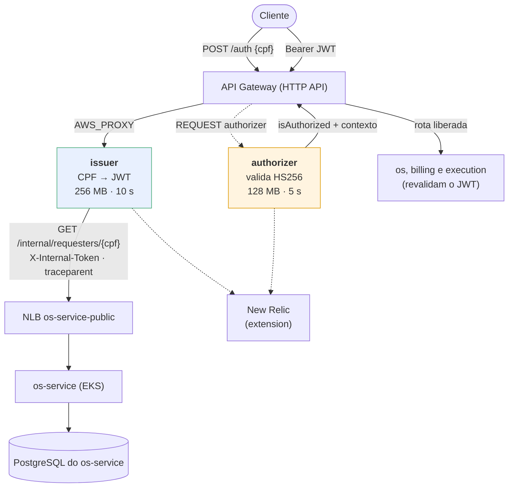
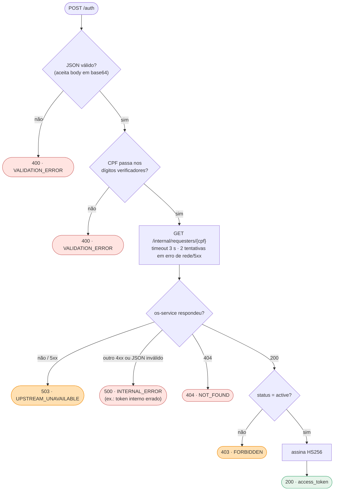
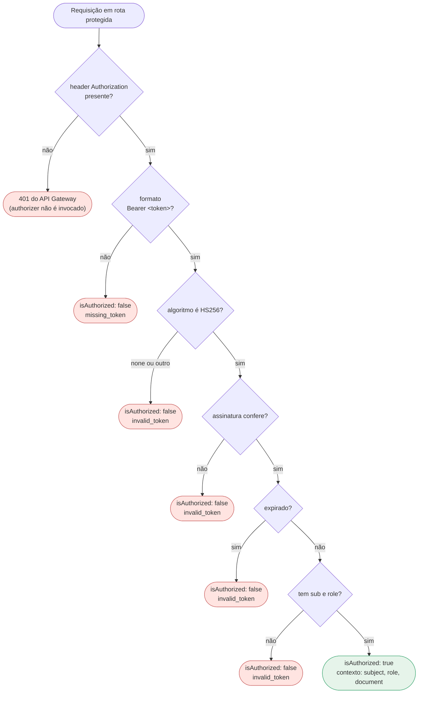

# postech-tc4-lambda-auth

**Autenticação serverless por CPF** da oficina mecânica. São duas functions AWS Lambda: o **issuer** troca o CPF do cliente por um JWT (`POST /auth`), e o **authorizer** é o Lambda authorizer do API Gateway, que valida o JWT antes de a requisição chegar aos serviços. O issuer não tem banco: confere no [os-service](https://github.com/Kc1t/postech-tc4-os-service) se o cliente existe e está ativo.

Tech Challenge Fase 4, FIAP Pós Tech SOAT. Go 1.26 em AWS Lambda (`provided.al2023`, arm64), `golang-jwt/v5` (HS256), New Relic (`nrlambda` e a layer da extension), logs JSON (`log/slog`), Terraform e GitHub Actions.

| Repositório | Papel | Banco |
|---|---|---|
| [postech-tc4-os-service](https://github.com/Kc1t/postech-tc4-os-service) | OS, clientes, veículos, catálogo e estoque; orquestrador da saga | PostgreSQL (RDS) |
| [postech-tc4-billing-service](https://github.com/Kc1t/postech-tc4-billing-service) | orçamento e pagamento com Mercado Pago | PostgreSQL (RDS) |
| [postech-tc4-execution-service](https://github.com/Kc1t/postech-tc4-execution-service) | fila de diagnóstico e reparo da oficina | DynamoDB |
| [postech-tc4-notification-lambda](https://github.com/Kc1t/postech-tc4-notification-lambda) | e-mail ao cliente a cada mudança de status da OS | DynamoDB (deduplicação) |
| **postech-tc4-lambda-auth** (este) | CPF → JWT e authorizer do API Gateway | (consulta o os-service) |
| [postech-tc4-infra-k8s](https://github.com/Kc1t/postech-tc4-infra-k8s) | EKS, API Gateway, SNS/SQS/DLQ, observabilidade, e2e local | — |

## Guia rápido para avaliação

| Entregável da fase 4 | Onde está |
|---|---|
| Código-fonte | `cmd/` e `internal/` ([Arquitetura](#arquitetura)) |
| Empacotamento e infraestrutura | zip com o binário `bootstrap` (`make package`) e Terraform das functions em [`infra/`](infra/). Não há Dockerfile nem manifesto Kubernetes: as functions rodam no runtime `provided.al2023` |
| Pipeline de CI/CD | [`.github/workflows/ci.yml`](.github/workflows/ci.yml) |
| Evidência de cobertura | **91,4%** no `go test` e **92,6%** no SonarQube, publicados no resumo de cada [execução do CI](https://github.com/Kc1t/postech-tc4-lambda-auth/actions/workflows/ci.yml) ([Testes](#testes-e-evidência-de-cobertura)) |
| Documentação da arquitetura do serviço | este README, de [Responsabilidades](#responsabilidades) a [Decisões e limitações](#decisões-e-limitações) |
| Contrato da API | [Contrato do `POST /auth`](#contrato-do-post-auth) e do [authorizer](#authorizer), mais a requisição "Token do cliente por CPF" da [collection Postman do os-service](https://github.com/Kc1t/postech-tc4-os-service/blob/main/postman_collection.json) |

## Responsabilidades

| Faz | Não faz |
|---|---|
| Valida o CPF (dígitos verificadores) antes de qualquer chamada de rede | Guardar dados de cliente (é do os-service) |
| Consulta o cliente no os-service pela rota interna `GET /internal/requesters/{cpf}` e só emite token para cliente ativo | Login da equipe (é o `POST /api/v1/auth/login` do os-service) |
| Emite o JWT do cliente (HS256, papel `client`, 15 min) | Decidir se o cliente é dono do recurso (cada serviço confere) |
| Valida, na borda, o JWT de toda rota protegida do API Gateway: o do cliente e o da equipe | Substituir a validação dos serviços, que revalidam o token |

### O que mudou da fase 3

| Fase 3 | Fase 4 |
|---|---|
| O issuer abria o PostgreSQL da aplicação e consultava `requesters` | O issuer chama `GET /internal/requesters/{cpf}` no os-service, com `X-Internal-Token`. Cada serviço é dono dos próprios dados ([ADR-0012](https://github.com/Kc1t/postech-tc4-os-service/blob/main/docs/adr/0012-banco-por-servico.md)) |
| Function dentro da VPC, por causa do RDS | Function fora da VPC: não precisa de banco e ganha saída para a internet sem NAT, que a extension do New Relic exige ([ADR-0014](https://github.com/Kc1t/postech-tc4-os-service/blob/main/docs/adr/0014-lambdas-fora-da-vpc.md)) |
| Só CloudWatch Logs | **New Relic** nas duas functions (layer da extension e `nrlambda`), com trace distribuído até o os-service e logs em contexto |
| Erro como `{"error": "texto"}` | Mesmo envelope dos serviços: `{"error": {"code", "message"}}` |

## Arquitetura



O `RoundTripper` do New Relic envolve o cliente HTTP: a chamada ao os-service vira um segmento externo e leva os headers W3C (`traceparent`/`newrelic`). Por isso o trace distribuído mostra **Lambda → os-service → Postgres** numa só linha do tempo.

| Pasta | Conteúdo |
|---|---|
| `cmd/issuer`, `cmd/authorizer` | `main` de cada function: configuração, cliente HTTP com New Relic e start |
| `internal/issuer` | handler do `POST /auth` (validação, respostas, atributos de telemetria) |
| `internal/authorizer` | handler do authorizer (payload 2.0, resposta simples) |
| `internal/requester` | cliente HTTP do os-service (timeout, retry, correlation id) |
| `internal/token` | emissão e verificação do JWT |
| `internal/cpf` | normalização e dígitos verificadores |
| `internal/mask` | mascaramento de CPF e e-mail nos logs (LGPD) |
| `internal/telemetry` | `trace.id`/`span.id` nos logs e atributos na transação do New Relic |
| `internal/runtime` | logger, variáveis obrigatórias e start com ou sem New Relic |
| `test/integration` | CPF → issuer → os-service real → JWT aceito pelo authorizer e pelo os-service |
| `infra/` | Terraform das functions, log groups e layer |

### Grafo de decisão do issuer



O CPF é validado **antes** da chamada de rede: CPF malformado nunca chega ao os-service. Só erros de rede e 5xx são repetidos, porque a consulta é idempotente. Um 401 indica configuração errada (token interno divergente), e repetir não resolveria.

### Grafo de decisão do authorizer



O authorizer aceita o token do cliente (emitido aqui) e também o da equipe (emitido pelo `POST /api/v1/auth/login` do os-service), porque os dois usam o mesmo `JWT_SECRET`. O algoritmo `none` e a troca de algoritmo são recusados com `jwt.WithValidMethods`.

## Comunicação

| Canal | Direção | Nome |
|---|---|---|
| API Gateway → issuer | entrada | rota `POST /auth` (integração `AWS_PROXY`, payload 2.0), sem authorizer |
| API Gateway → authorizer | entrada | authorizer `REQUEST` de todas as rotas protegidas (payload 2.0, resposta simples) |
| issuer → os-service | saída | `GET /internal/requesters/{cpf}` no NLB `os-service-public` |

Nenhuma das functions publica ou consome mensagens SNS/SQS.

### Contrato do `POST /auth`

Rota pública do API Gateway, com limite próprio de 10 requisições por segundo (rajada de 20) contra enumeração de CPF.

**Requisição**

```http
POST /auth
Content-Type: application/json
X-Correlation-ID: 3f1c...   (opcional)

{"cpf": "529.982.247-25"}
```

O CPF pode vir com ou sem pontuação: só os dígitos contam. O corpo também é aceito em base64 (`isBase64Encoded`), como o API Gateway entrega em alguns clientes.

**Resposta 200**

```json
{
  "access_token": "eyJhbGciOiJIUzI1NiIs...",
  "token_type": "Bearer",
  "expires_at": "2026-11-01T12:15:00Z",
  "expires_in": 900
}
```

**Erros**, sempre no envelope `{"error": {"code": "...", "message": "..."}}`:

| HTTP | `code` | `message` | Quando |
|---|---|---|---|
| 400 | `VALIDATION_ERROR` | `payload invalido` | corpo que não é JSON ou base64 inválido |
| 400 | `VALIDATION_ERROR` | `cpf invalido` | CPF sem 11 dígitos, com todos os dígitos iguais ou com dígito verificador errado |
| 403 | `FORBIDDEN` | `cliente inativo` | cliente existe, mas não está `active` |
| 404 | `NOT_FOUND` | `cliente nao encontrado` | CPF válido sem cadastro no os-service |
| 503 | `UPSTREAM_UNAVAILABLE` | `servico de clientes indisponivel, tente novamente` | os-service fora do ar, timeout ou 5xx depois das 2 tentativas |
| 500 | `INTERNAL_ERROR` | `erro interno` | os-service respondeu outro 4xx (ex.: 401 por token interno errado) ou JSON inválido, ou falha ao assinar o token |

**Headers de toda resposta**: `Content-Type: application/json`, `Cache-Control: no-store` e `X-Correlation-ID` (o do cliente, se veio na requisição, ou o request id do API Gateway). O mesmo id segue para o os-service e aparece nos logs dos dois lados.

**Claims do token**

| Claim | Valor |
|---|---|
| `sub` | id do cliente no os-service |
| `role` | `client` (o login da equipe no os-service emite tokens `admin`) |
| `email`, `name`, `document` | dados do cliente; `document` é o CPF só com dígitos, usado pelos serviços na regra de dono do recurso |
| `iat`, `exp` | emissão e expiração (`JWT_TTL`, padrão 15 min) |

```bash
curl -s -X POST "$GATEWAY/auth" -H 'Content-Type: application/json' -d '{"cpf":"52998224725"}'
```

### Authorizer

Contrato com o API Gateway (configurado no [postech-tc4-infra-k8s/api_gateway.tf](https://github.com/Kc1t/postech-tc4-infra-k8s/blob/main/api_gateway.tf)): tipo `REQUEST`, payload 2.0, respostas simples, identity source `$request.header.Authorization` e cache desligado (TTL 0), para um token revogado ou expirado não continuar aceito.

| Situação | Resultado para o cliente |
|---|---|
| sem header `Authorization` | **401** do API Gateway, sem invocar o authorizer (identity source ausente) |
| header presente, mas fora do formato `Bearer <token>` | authorizer devolve `isAuthorized: false` → **403** |
| token com algoritmo diferente de HS256, assinatura errada, expirado, ou sem `sub` ou `role` | `isAuthorized: false` → **403** |
| token válido | `isAuthorized: true`, com o contexto `subject`, `role` e `document`; a requisição segue para o serviço |

O header `Authorization` segue intacto para o serviço, que valida o JWT de novo.

### Chamada ao os-service

`GET /internal/requesters/{cpf}` no NLB `os-service-public`, com `X-Internal-Token` (o mesmo `INTERNAL_API_TOKEN` do os-service), `X-Correlation-ID` e os headers do trace distribuído. Timeout de 3 s por tentativa (`UPSTREAM_TIMEOUT`), 2 tentativas com 150 ms de espera, só em erro de rede ou 5xx. A resposta usada tem `id`, `name`, `email`, `document` e `status`.

A rota `/internal/*` não existe no API Gateway: só é acessível pelo NLB e, mesmo assim, exige o token interno (comparação em tempo constante no os-service).

### Swagger e Postman

As functions não servem HTTP próprio, então não há Swagger aqui: o contrato está acima. Para chamar o `POST /auth`:

- **Postman**: a [collection do os-service](https://github.com/Kc1t/postech-tc4-os-service/blob/main/postman_collection.json) tem a requisição "Token do cliente por CPF (Lambda issuer, só pelo gateway)", em `{{gateway_url}}/auth`.
- **Local**: o ambiente e2e do [postech-tc4-infra-k8s/local](https://github.com/Kc1t/postech-tc4-infra-k8s/tree/main/local) publica o issuer no LocalStack (`make lambdas`) e o expõe em `POST http://localhost:8090/auth` pelo gateway local (`make gateway`).

## Banco e modelo de dados

Este repositório não tem banco. O cliente é dono do os-service, que o expõe pela rota interna; a Lambda só lê. O único estado emitido é o próprio JWT, sem armazenamento: não há sessão nem refresh token do cliente, e o token expira em 15 minutos.

## Segurança

- **Duas camadas de JWT**: o authorizer barra token ausente, inválido ou expirado na borda, e cada serviço valida o token de novo (HS256, `exp` obrigatório, papel por rota). Quem confere se o cliente é **dono do recurso** é o serviço: o os-service e o billing comparam a claim `document` com o CPF da OS ou do orçamento e devolvem **403** quando não é o dono. O teste de integração deste repositório cobre esse 403 com um token real emitido aqui.
- **Algoritmo fixo**: o token é assinado em HS256, e na verificação `alg=none` e troca de algoritmo são recusados (`jwt.WithValidMethods`).
- **Sem segredo vazio**: `OS_SERVICE_URL`, `INTERNAL_API_TOKEN` e `JWT_SECRET` são obrigatórias; sem elas a function falha já no cold start (`variavel obrigatoria ausente`), em vez de emitir token com segredo vazio.
- **Enumeração de CPF**: limite de 10 req/s (rajada de 20) na rota `POST /auth`, CPF validado antes da rede e mensagens de erro que não revelam dados do cliente.
- **Dados pessoais**: o CPF só aparece mascarado nos logs (`***.***.***-25`); `Cache-Control: no-store` em todas as respostas.
- **Rota interna protegida**: `/internal/*` fora do API Gateway e com `X-Internal-Token`.
- **Credenciais**: as functions usam a `LabRole` (o Learner Lab não permite criar IAM), e os segredos chegam por variáveis de ambiente definidas pelo Terraform a partir dos GitHub Secrets.

## Observabilidade

New Relic pelas duas peças: `nrlambda` abre uma transação por invocação, e a layer `NewRelicLambdaExtensionARM64` envia traces e logs (`NEW_RELIC_EXTENSION_SEND_FUNCTION_LOGS=true`). Com `NEW_RELIC_APM_LAMBDA_MODE=true`, as invocações chegam como `Transaction`, as mesmas consultas dos serviços. Sem a licença, o Terraform não instala a layer e as functions sobem com `lambda.Start` puro.

- **Trace**: a chamada ao os-service continua o trace distribuído (Lambda → os-service → Postgres).
- **Logs em contexto**: JSON com o texto em `message` e `trace.id`, `span.id` e `entity.guid`. Nível por `LOG_LEVEL`.
- **Atributos na transação**: `auth.outcome`, `auth.role` (authorizer), `requester_id`, `correlation_id` e, no issuer, `http.statusCode`. O `nrlambda` só lê o status da resposta v1 do API Gateway, então o handler grava o da v2; com isso o issuer entra nas mesmas consultas de 4xx/5xx dos serviços. Falhas de 5xx são marcadas com `NoticeError`.

| `auth.outcome` | Function | Log |
|---|---|---|
| `issued` | issuer | `token emitido` |
| `invalid_payload` / `invalid_cpf` | issuer | `payload invalido` / `cpf invalido` |
| `not_found` / `inactive` | issuer | `cliente nao encontrado` / `cliente inativo` |
| `upstream_unavailable` | issuer | `os-service indisponivel` |
| `error` | issuer | `falha ao consultar cliente` ou `falha ao assinar token` |
| `missing_token` | authorizer | `authorization header ausente ou malformado` |
| `invalid_token` | authorizer | `token rejeitado` (com `error`, `request_id` e `route`) |
| `allowed` | authorizer | `token aceito` |

```sql
SELECT count(*) FROM Transaction
WHERE aws.lambda.arn LIKE '%:function:postech-tc4-prod-auth-issuer%'
FACET auth.outcome TIMESERIES
```

Alertas que cobrem as functions (Terraform em [postech-tc4-infra-k8s/observability](https://github.com/Kc1t/postech-tc4-infra-k8s/tree/main/observability), cada um com runbook em [`docs/runbooks`](https://github.com/Kc1t/postech-tc4-infra-k8s/tree/main/docs/runbooks)):

| Alerta | Condição |
|---|---|
| `lambda issuer: taxa de erro acima de 5% em 5 min` | invocações com erro sobre o total |
| `lambda authorizer: taxa de erro acima de 5% em 5 min` | idem |
| `lambda authorizer: mais de 50 requisições negadas em 5 min` | `auth.outcome` `missing_token` ou `invalid_token`; aviso acima de 25 |

## Configuração

| Variável | Function | Padrão | Descrição |
|---|---|---|---|
| `OS_SERVICE_URL` | issuer | — (obrigatória) | URL do os-service. No Terraform, vazio = procura o NLB `os-service-public` pela tag do Kubernetes |
| `INTERNAL_API_TOKEN` | issuer | — (obrigatória) | mesmo valor do os-service |
| `JWT_SECRET` | as duas | — (obrigatória) | segredo HS256, o mesmo dos serviços |
| `JWT_TTL` | issuer | `15m` | validade do token |
| `UPSTREAM_TIMEOUT` | issuer | `3s` | timeout de cada tentativa ao os-service |
| `LOG_LEVEL` | as duas | `info` | nível do log |
| `NEW_RELIC_*` | as duas | — | definidas pelo Terraform quando há licença |

O [`.env.example`](.env.example) tem os valores para o teste de integração com o compose do os-service.

## Como rodar localmente

```bash
make test         # testes de unidade com race
make cover        # cobertura de internal/
make lint         # golangci-lint (gosec, errorlint, bodyclose, noctx...)
make package      # issuer.zip e authorizer.zip (bootstrap linux/arm64)
```

Teste de integração com o os-service de verdade: suba o `docker compose` do [postech-tc4-os-service](https://github.com/Kc1t/postech-tc4-os-service) e rode o `scripts/smoke-saga.sh` dele uma vez para cadastrar o cliente de teste.

```bash
make integration  # usa OS_SERVICE_URL=http://localhost:8080 e INTERNAL_API_TOKEN=local-internal-token
```

Para a function rodando dentro do LocalStack, atrás de um gateway local, use o e2e do [postech-tc4-infra-k8s/local](https://github.com/Kc1t/postech-tc4-infra-k8s/tree/main/local) (`make up lambdas gateway`). O gateway local não emula o authorizer: lá, quem barra a requisição sem token são os próprios serviços.

## Testes e evidência de cobertura

| Pacote | Cobertura | O que cobre |
|---|---|---|
| `internal/requester` | 97,8% | 200, 404, inativo, 5xx com retry, recuperação na 2ª tentativa, rede fora, contexto cancelado, 401 sem retry, JSON inválido |
| `internal/authorizer` | 96,0% | token válido, header em outra caixa, ausente, sem esquema, vazio, expirado, outro segredo |
| `internal/issuer` | 95,3% | token emitido e verificável, body em base64, todos os erros e o correlation id |
| `internal/cpf` | 94,1% | dígitos verificadores, formatação, sequências repetidas |
| `internal/telemetry` | 90,9% | logs com e sem transação |
| `internal/token` | 81,8% | emissão, verificação, segredo errado, expirado, algoritmo `none` |
| `internal/mask` | 100% | mascaramento de CPF e e-mail |
| `internal/runtime` | 65,2% | logger (texto em `message`) e variáveis de ambiente; o `Start` com New Relic e o `os.Exit` do `Require` só rodam dentro da Lambda |
| **Total (`internal/`)** | **91,4%** | |

O teste de integração (`make integration`, build tag `integration`) cobre: token emitido, aceito pelo authorizer e pela rota do cliente no os-service; **403** ao consultar o CPF de outra pessoa; 404 para CPF sem cadastro; e 500 com token interno errado.

**Evidência de cobertura:** **91,4%** no `go test` e **92,6%** no SonarQube, com o quality gate aprovado (0 bugs, 0 vulnerabilidades, 0 code smells, 0% de duplicação). Cada execução do [CI](https://github.com/Kc1t/postech-tc4-lambda-auth/actions/workflows/ci.yml) publica no resumo do job a cobertura e a tabela do SonarQube; o pipeline reprova abaixo de 80%.

## CI/CD e deploy

Pipeline próprio em [`.github/workflows/ci.yml`](.github/workflows/ci.yml), em PR e push.

| Job | O que faz |
|---|---|
| Lint, SAST e testes | `go mod tidy` limpo, `gofmt`, `go vet`, golangci-lint, gosec, testes com race, **cobertura mínima de 80%** e govulncheck |
| SonarQube (quality gate) | sobe o SonarQube Community num container do próprio job (o repositório é privado), cria um quality gate (cobertura ≥ 80%, duplicação ≤ 3%, nota A em confiabilidade, segurança e manutenibilidade), importa a cobertura e os relatórios do golangci-lint e do gosec, e falha se o gate reprovar ([`.github/scripts/sonar.sh`](.github/scripts/sonar.sh)) |
| Terraform (fmt, validate, tfsec) | `fmt -check`, `validate` e tfsec; as exceções têm a justificativa no próprio `main.tf` (Learner Lab sem CMK, trace pelo New Relic em vez do X-Ray) |
| Deploy | só em push na `main` com `AWS_DEPLOY_ENABLED=true`: `make package`, `terraform apply` (state `lambda-auth/prod.tfstate`, ambiente único, [ADR-0021](https://github.com/Kc1t/postech-tc4-os-service/blob/main/docs/adr/0021-ambiente-unico-no-eks.md)), smoke test com `aws lambda invoke` (CPF `000` deve dar `VALIDATION_ERROR`) e os nomes das functions no resumo do job |

A `main` é protegida: só recebe PR, com a branch atualizada, conversas resolvidas e os três primeiros jobs obrigatórios, inclusive para administradores. O deploy depende da variável `AWS_DEPLOY_ENABLED=true` porque as credenciais do Learner Lab expiram a cada sessão.

Secrets do ambiente: `AWS_ACCESS_KEY_ID`, `AWS_SECRET_ACCESS_KEY`, `AWS_SESSION_TOKEN`, `TF_STATE_BUCKET`, `INTERNAL_API_TOKEN`, `JWT_SECRET` e `NEW_RELIC_LICENSE_KEY`. Variáveis: `AWS_REGION`, `OS_SERVICE_URL` (opcional) e `NEW_RELIC_ACCOUNT_ID`.

O Terraform cria `postech-tc4-prod-auth-issuer` (256 MB, 10 s) e `postech-tc4-prod-auth-authorizer` (128 MB, 5 s), arm64, com a `LabRole` e log groups de 14 dias. O `source_code_hash` dos zips dispara a atualização no `apply`. A URL do os-service sai do NLB que o Kubernetes cria para o Service `os-service-public` (tag `kubernetes.io/service-name = postech/os-service-public`); por isso a ordem de deploy é cluster → os-service → lambda-auth → rotas do gateway no [postech-tc4-infra-k8s](https://github.com/Kc1t/postech-tc4-infra-k8s), que acha as functions pelo nome.

## Decisões e limitações

- **Functions fora da VPC** ([ADR-0014](https://github.com/Kc1t/postech-tc4-os-service/blob/main/docs/adr/0014-lambdas-fora-da-vpc.md)): o issuer não precisa de banco e a extension do New Relic precisa de internet, que dentro da VPC exigiria NAT. Em troca, o issuer chega ao os-service pelo NLB público, e a rota interna depende do `X-Internal-Token`. Num ambiente sem as restrições do Learner Lab, o próximo passo seria um NLB interno com VPC Link e a function na VPC com NAT.
- **Segredo HS256 compartilhado**: o mesmo `JWT_SECRET` assina e valida em todos os componentes, o que simplifica a borda e a revalidação nos serviços. Trocar por assinatura assimétrica (RS256 com JWKS) tiraria o segredo de quem só valida.
- **Sem cache no authorizer** (TTL 0): cada requisição protegida invoca o authorizer. Custa uma invocação a mais por requisição, mas um token expirado deixa de valer na hora.
- **Token curto e sem refresh para o cliente**: 15 minutos; o cliente pede outro token pelo CPF quando expira.
